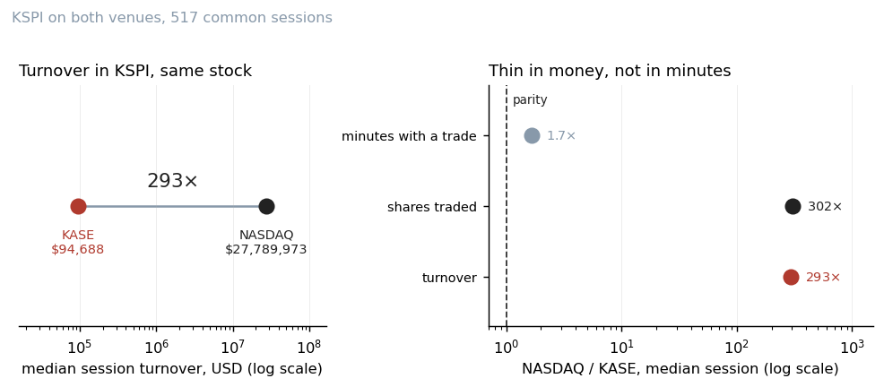
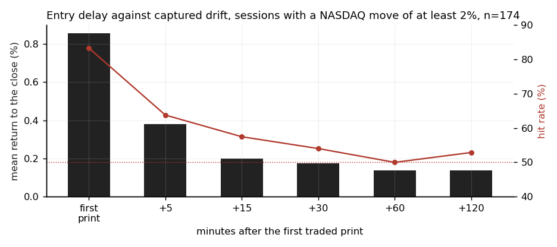
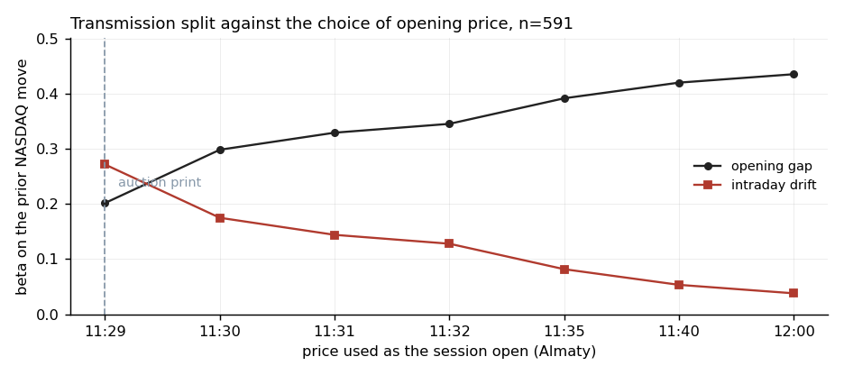
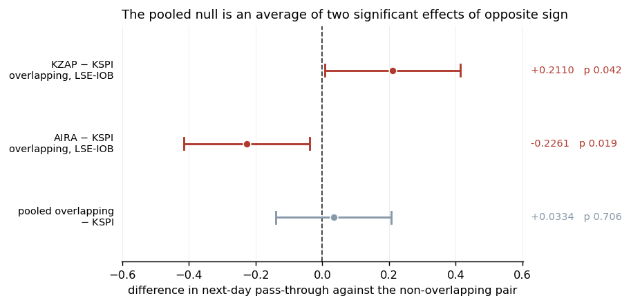

# Price discovery between KASE and its foreign co-listing venues

How fast does a thin local market absorb a foreign price move that arrived while it was closed?
Kaspi.kz (KSPI) trades on the Kazakhstan Stock Exchange (KASE) and on NASDAQ, and the two regular
sessions share no clock time. This repository measures the KASE reaction minute by minute, splits
it between the opening auction and the session, conditions it on the NASDAQ pre-market prints that
are visible during the KASE session, and contrasts it with two co-listings that do overlap their
foreign venue. The write-up is `docs/price-discovery.md`; this README is the summary and the
instructions for reproducing it.

## Findings

- On the 174 sessions where NASDAQ moved at least 2%, the KASE return from the first traded print
  to the close, in the direction of the NASDAQ move, is +0.856%. From five minutes after the first
  print it is +0.380%, from thirty minutes +0.173%, and 81.1% of the full-session drift has
  accrued by 12:00, thirty minutes into the session. That is the speed Thorp and Milunovich (2006)
  report for New York, up to 30 minutes, on a venue with one 293rd of NASDAQ's dollar turnover in
  the stock.
- Regressing 591 KASE sessions (January 2024 to August 2026) on the prior NASDAQ close-to-close
  move, with Newey-West HAC(5) errors, gives an opening-gap beta of 0.2019 (t 10.50) and an
  intraday-drift beta of 0.2718 (t 12.49); total pass-through is 0.4741 (t 16.73). Calling the
  first continuous trade the open instead of the 11:29 auction print moves 0.0967 of beta from the
  drift to the gap; by 12:00 the drift beta is 0.0380.
- Zero session overlap is not zero information overlap. 1,286 of 2,855 NASDAQ pre-market bars fall
  inside a KASE session. Conditioning the drift on the last visible pre-market print raises the
  lagged coefficient from 0.167861 to 0.199755 rather than lowering it; the Craig-Dravid-Richardson
  critique does not remove the overnight channel here.
- KZAP and AIRA trade on KASE and on the LSE International Order Book, sharing a median 314 and
  325 minutes with the KASE session. Overlap separates the three pairs on how much of the foreign
  day has arrived by the KASE close (covariance shares 0.0996, 0.6686, 0.7183). It does not
  identify a difference in absorption rate: the pooled contrast on next-day pass-through is
  +0.0334 with interval [-0.1405, +0.2073], and the two pair contrasts, +0.2110 and -0.2261, are
  each distinguishable from zero with opposite signs.
- The drift is not capturable by a participant who cannot set the opening print. Roll and
  Corwin-Schultz estimates of the full spread are 0.24% and 0.47%; with commission of 0.085% per
  side the round trip is 0.41% or 0.64%, and the five-minute entry return of +0.380% falls short
  of both, by 0.033 and 0.257 percentage points.
- The 20 December to 10 January window on a nine-name KASE basket returns a mean of +3.148% over
  eleven windows (t 3.574, 10 of 11 positive) under a five-bar admission floor whose sensitivity is
  reported. On the same eleven windows SPY returns +1.24% and EEM +2.80%, and the KASE series
  correlates 0.61 with SPY; without the one adverse window, 2015, the correlation is -0.02. The
  t is uncorrected for the choice of window.

## Data

The scripts read three stores, all assembled by the companion `kase-market-data` repository from a
retail broker's chart-data endpoint (Tradernet): 1-minute bars of KASE equities and the
on-exchange `USDKZT_TOM` rate, 1-minute bars of KSPI on NASDAQ, and a daily companion series. The
bars are not redistributed; `data/README.md` says what is committed, what is not, and how to attach
the stores with the `KASE_STORE` and `KASE_DAILY` environment variables. The KSPI daily series
behind the headline regressor is fetched from Yahoo Finance at run time, as are the SPY and EEM
series of the year-end comparison. The foreign legs of the overlap comparison were also fetched
from Yahoo; the repository commits the derived tables `data/derived/foreign_daily.csv` and
`foreign_split.csv`, not the chart data.

The transmission sample is 591 KASE sessions from KSPI's NASDAQ listing in January 2024 to August
2026. The cross-pair window starts in February 2024, with 626 sessions for KSPI and KZAP and 619
for AIRA; the composition and conditional estimates for the two IOB pairs run on hourly bars that
begin in late August 2024. Regression t-statistics are Newey-West HAC at lag 5 and asymptotic
unless the write-up says otherwise.

## Method

1. Build a session panel: the prior foreign close-to-close move, the KASE opening gap from the
   11:29 auction print, and the KASE intraday drift, in USD at the on-exchange rate.
2. Measure KASE and NASDAQ liquidity in KSPI over the sessions both venues traded.
3. Decompose the drift by entry delay from the first actual trade, exit at the close, on sessions
   where the foreign move was at least 2%.
4. Regress gap and drift on the prior foreign move with HAC(5) errors, trimmed at 1%/99%; repeat
   with the open placed at each print from 11:29 to 12:00; repeat on the sessions whose gap spans
   exactly one NASDAQ session and on the NASDAQ return over the span the gap covers; condition on
   the last NASDAQ pre-market print inside the KASE session.
5. Count shared trading minutes; repeat the regressions for KZAP and AIRA against the LSE
   International Order Book on the foreign segment after the KASE close; stack the three pairs into
   a balanced panel with Driscoll-Kraay HAC(5) errors.
6. Price the 20 December to 10 January window close-to-close over eleven windows under a stated
   admission rule, and run the same window on SPY and EEM.

## Results

Script names under each table cover every entry in it.

KSPI liquidity on both venues over 517 common sessions from 2024-01-19, NASDAQ restricted to the
regular session, the KASE side converted at the on-exchange rate.

| quantity | KASE | NASDAQ | ratio |
|---|---|---|---|
| median minutes with a trade | 124 | 206 | 1.7x |
| median shares traded | 952 | 287,858 | 302x |
| median turnover, USD | 94,688 | 27,789,973 | 293x |

Produced by `analysis/transmission/venue_liquidity.py`. Bars are minutes with at least one trade,
so the first row is a lower bound on trade counts. A KASE session runs 370 minutes and trades in a
median of 124 of them, one minute with a trade per 3.0 minutes of clock.

Session return by entry delay from the first traded print, exit at the close, on the 174 sessions
where NASDAQ moved at least 2%, raw tenge, in the direction of the move.

| entry | mean return | hit rate | net of a 0.41% round trip | net of a 0.64% round trip |
|---|---|---|---|---|
| first traded print | +0.856% | 83.3% | +0.443% | +0.219% |
| +5 minutes | +0.380% | 63.8% | -0.033% | -0.257% |
| +15 minutes | +0.200% | 57.5% | -0.213% | -0.437% |
| +30 minutes | +0.173% | 54.0% | -0.240% | -0.464% |
| +60 minutes | +0.136% | 50.0% | -0.277% | -0.501% |
| +120 minutes | +0.138% | 52.9% | -0.275% | -0.499% |

Produced by `analysis/transmission/entry_timing.py` (returns and hit rates) and
`analysis/transmission/transmission_tradeable.py` (net columns). Cumulated from the first print,
81.1% of the full-session drift has accrued by 12:00.

KSPI on KASE regressed on the prior NASDAQ close-to-close move, open at the 11:29 auction print,
HAC(5).

| component | beta | t | R2 | n |
|---|---|---|---|---|
| opening gap | 0.2019 | 10.50 | 0.284 | 591 |
| intraday drift | 0.2718 | 12.49 | 0.227 | 591 |
| previous close to close | 0.4741 | 16.73 | 0.427 | 591 |
| opening gap, sessions whose gap spans one NASDAQ session | 0.2095 | 10.32 | 0.304 | 541 |
| intraday drift, same sessions | 0.2727 | 12.62 | 0.235 | 541 |

Produced by `analysis/transmission/hac_inference.py`. The total is estimated on its own return, not
summed from the components; the sum of the two component betas is 0.4737. The next NASDAQ move,
which cannot reach today's KASE session, gives betas of +0.0141 (t 1.06) and +0.0020 (t 0.08) on
the same two dependent variables, and KASE's own prior move gives -0.0182 (t -0.41) on the drift.

Next-day pass-through of foreign news arriving after the KASE close, overlapping pairs against the
non-overlapping one, balanced panel of 381 dates and 1,143 pair-days, Driscoll-Kraay HAC(5).

| contrast | estimate | se | p | 95% interval |
|---|---|---|---|---|
| pooled overlapping minus KSPI | +0.0334 | 0.0887 | 0.7063 | [-0.1405, +0.2073] |
| KZAP minus KSPI | +0.2110 | 0.1039 | 0.0423 | [+0.0074, +0.4147] |
| AIRA minus KSPI | -0.2261 | 0.0963 | 0.0189 | [-0.4148, -0.0373] |

Produced by `analysis/transmission/overlap_comparison.py`. An overlap effect and a stock effect
are not separately identified across two overlapping units.

The year-end window, equal-weighted nine-name basket, close to close, minute store with a five-bar
admission floor wherever it prices a window and the daily companion for the 2015 window alone.

| construction | n | mean | sd | t | positive |
|---|---|---|---|---|---|
| 2016 to 2025, minute store | 10 | +3.855% | 1.836% | 6.638 | 10 of 10 |
| 2015 to 2025, spliced (the estimate) | 11 | +3.148% | 2.921% | 3.574 | 10 of 11 |
| without the floor, every print counts, spliced | 11 | +3.354% | 3.586% | 3.102 | 9 of 11 |

Produced by `analysis/calendar/yearend_constructions.py`. SPY and EEM over the same eleven windows
return +1.24% and +2.80% (`analysis/calendar/yearend_global_decomposition.py`).

## Repository contents

- `analysis/_store.py`: resolves the bar store and the daily companion for every script.
- `analysis/transmission/intraday_transmission.py`: session panel and OLS betas. Writes
  `data/derived/transmission_daily.csv` and `regressor_alignment.csv`.
- `analysis/transmission/hac_inference.py`: HAC(5) transmission coefficients, the alignment rows,
  the two opening conventions, the placebos and the measurement-point curve. Writes
  `data/derived/measurement_point_curve.csv`.
- `analysis/transmission/venue_liquidity.py`: KASE against NASDAQ liquidity in KSPI. Writes
  `data/derived/venue_liquidity.csv`.
- `analysis/transmission/entry_timing.py`: entry-delay decomposition. Writes
  `data/derived/entry_delay.csv`.
- `analysis/transmission/overlap_comparison.py`: cross-pair betas, composition shares, conditional
  test, panel contrasts, common-factor weights. Writes `data/derived/overlap_contrasts.csv`.
- `analysis/transmission/foreign_legs.py`: builds `data/derived/foreign_daily.csv` and
  `foreign_split.csv` from Yahoo chart data that is not in this tree; see `data/README.md`.
- `analysis/transmission/foreign_session_conditioning.py`: pre-market conditioning.
- `analysis/transmission/transmission_robustness.py`: FX, sub-period, threshold-selection and
  placebo checks.
- `analysis/transmission/transmission_tradeable.py`: spread estimates, their census, round trips
  and net returns. Writes `data/derived/spread_estimates.csv`.
- `analysis/calendar/yearend_constructions.py`: the year-end window, its admission rule, the floor
  sensitivity, the source comparison and the net-of-cost table.
- `analysis/calendar/yearend_global_decomposition.py`: the same window on SPY and EEM. Writes
  `data/derived/yearend_windows.csv`.
- `analysis/panel_diagnostics.py`: panel coverage, non-trading weekdays, venue events, session
  bounds.
- `analysis/make_figures.py`: draws `figures/paper/*.png` from `data/derived/`. Computes nothing.
- `analysis/check_figure_literals.py`: fails if the plotting code contains an unclassified numeric
  literal, an analysis call, or a data read from outside `data/derived/`.
- `data/README.md`: what is committed, what is not, and how to attach the stores.
- `data/derived/`: ten CSV files, each written by one of the scripts above.
- `docs/price-discovery.md`: the write-up. `docs/reproducibility.md`: the reproducibility policy
  and the record of the clean-clone gate.
- `RELEASE.md`: the plan for the public copy.
- `CITATION.cff`, `LICENSE`, `requirements.txt`.

## How to run

Python 3.13 with pandas, numpy, scipy, statsmodels, pyarrow and matplotlib, in the version ranges
of `requirements.txt`. Rebuild the bar store with `kase-market-data` first (hours), attach it as
`data/README.md` describes, then run in this order; each script prints its results and the first
writes the panel the others read.

```sh
python analysis/transmission/intraday_transmission.py
python analysis/transmission/hac_inference.py
python analysis/transmission/venue_liquidity.py
python analysis/transmission/entry_timing.py
python analysis/transmission/overlap_comparison.py
python analysis/transmission/foreign_session_conditioning.py
python analysis/transmission/transmission_robustness.py
python analysis/transmission/transmission_tradeable.py
python analysis/panel_diagnostics.py
python analysis/calendar/yearend_constructions.py
python analysis/calendar/yearend_global_decomposition.py
python analysis/make_figures.py
python analysis/check_figure_literals.py
```

`foreign_legs.py` is not in the list: it rebuilds the two foreign-leg tables from Yahoo chart data
that this tree does not hold, and the hourly bars it used are no longer served, so the committed
tables are the input. Two scripts reach the network at run time, `intraday_transmission.py` for
the KSPI daily series and `yearend_global_decomposition.py` for SPY and EEM.

## Figures

Every figure is drawn from a file under `data/derived/` written by an analysis script; the plotting
code contains no measurement, and `analysis/check_figure_literals.py` enforces that.

The venue, measured against NASDAQ in the same stock over the same sessions.



Absorption speed on sessions where NASDAQ moved at least 2%.



The split between the opening gap and the intraday drift against the price called the open.



What a three-pair contrast identifies: the pooled contrast sits on zero because the two pair
contrasts are each distinguishable from zero with opposite signs.



## Exhibit map

| exhibit | script | output |
|---|---|---|
| Venue liquidity | `analysis/transmission/venue_liquidity.py` | `data/derived/venue_liquidity.csv`, stdout |
| Entry-delay table | `analysis/transmission/entry_timing.py` | `data/derived/entry_delay.csv`, stdout |
| Session panel, alignment table | `analysis/transmission/intraday_transmission.py` | `data/derived/transmission_daily.csv`, `regressor_alignment.csv`, stdout |
| Transmission table, alignment rows, opening conventions, placebos, measurement-point curve | `analysis/transmission/hac_inference.py` | `data/derived/measurement_point_curve.csv`, stdout |
| Cross-pair tables, composition, contrasts, common-factor weights | `analysis/transmission/overlap_comparison.py` | `data/derived/overlap_contrasts.csv`, stdout |
| Foreign-leg tables | `analysis/transmission/foreign_legs.py` | `data/derived/foreign_daily.csv`, `foreign_split.csv` |
| Pre-market conditioning | `analysis/transmission/foreign_session_conditioning.py` | stdout |
| FX, regimes, threshold sweep, placebos | `analysis/transmission/transmission_robustness.py` | stdout |
| Spreads, round trips, net returns | `analysis/transmission/transmission_tradeable.py` | `data/derived/spread_estimates.csv`, stdout |
| Panel coverage, events, session bounds | `analysis/panel_diagnostics.py` | stdout |
| Year-end window, floor sensitivity, costs | `analysis/calendar/yearend_constructions.py` | stdout |
| Year-end against SPY and EEM | `analysis/calendar/yearend_global_decomposition.py` | `data/derived/yearend_windows.csv`, stdout |
| Figures | `analysis/make_figures.py` | `figures/paper/*.png` |

## Verification

The repository was verified on 2026-10-12, in an unpublished read-only re-derivation
of its numbers from the bar store and a review of its code against the write-up. It found four
substantive defects, all corrected here, and the write-up says where: the two spread estimators
return the full spread, so the round trips are 0.41% and 0.64% rather than the doubled spreads an
earlier version charged; the one-session NASDAQ regressor and
the opening gap do not cover the same sessions on 50 of the 591 rows, now counted and re-estimated;
the first-half threshold sweep selects 3% rather than the 2% rule used throughout, now reported
with the 2% rule's own out-of-sample row; and the two year-end constructions differed by leg
admission, now one construction with its floor stated and its sensitivity shown. A second
re-derivation of this version's code on 2026-10-28 matched every changed number and
found one further defect, since fixed: the foreign price at the KASE close in the overlap split
was taken at bar boundaries by an unstable sort, so the rule is now stated and deterministic. A
later and stricter re-analysis of the same market (2026-10-16), also unpublished, is drawn
on in the write-up where it bears on a result here; the write-up states each such finding in place.

`docs/reproducibility.md` records the clean-clone gate: every derived file regenerates
byte-identically from the bar stores and the two Yahoo series fetched at run time, every number
in the documents is matched against script output, and the figure code passes the literal check.

## Limitations

Costs are estimated from trade prints, not measured from quotes, and the two estimators disagree by
a factor of two; every net figure is given against both. Absorption is measured from trades, and
exit at the close is a last print rather than a fill. The headline regressor is joined by calendar
day; the aligned-only and interval-return rows move the betas in the third decimal. Returns are
dividend-unadjusted. The two IOB pairs' composition rests on hourly foreign bars from late August
2024. Two overlapping units do not identify an overlap effect separately from a stock effect. The
year-end result rests on eleven annual observations from currently listed names under a stated but
free admission floor, with a t uncorrected for the choice of window. Robustness checks with no
committed producer were removed rather than restated.

## Licence

MIT, see `LICENSE`. The bar stores the scripts read are not part of this repository and carry
their own terms; `data/README.md` describes the sources of every committed table.

## Citation

```bibtex
@misc{amankeldy2026kasepricediscovery,
  author = {Amankeldy, Zhan},
  title  = {Price discovery between KASE and its foreign co-listing venues},
  year   = {2026},
  url    = {https://github.com/zhan-a/kase-price-discovery}
}
```
